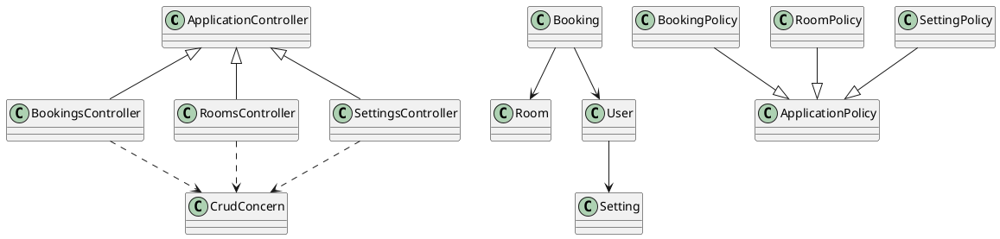
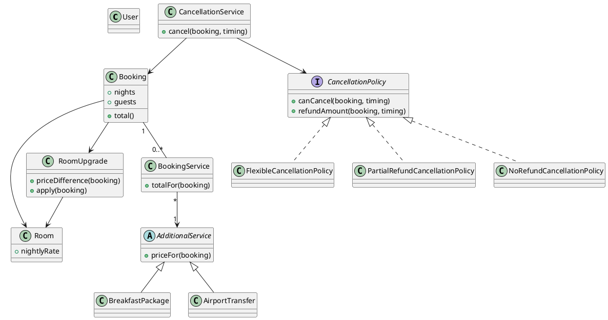
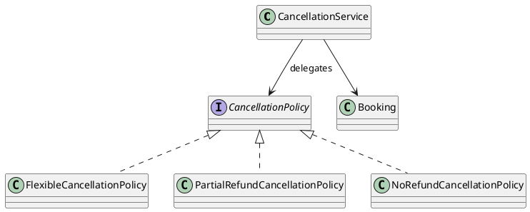
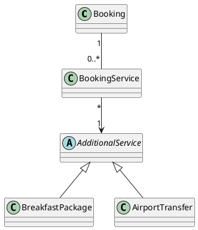
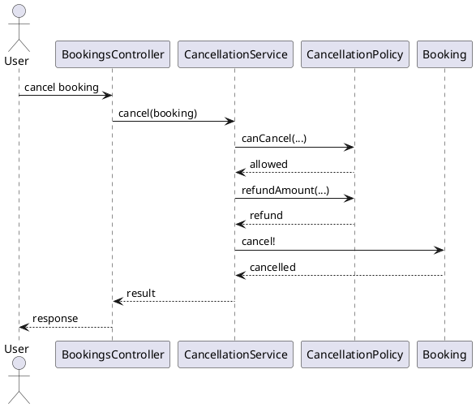

# A. Executive Audit Summary

The case study is **internally consistent after audit**, with one important submission-status distinction preserved throughout:

- **Original Rails baseline:** one confirmed application-level GoF pattern — **Template Method**.
- **Evolved design / Part 3:** **Strategy** is concretely implemented in the four non-Ruby demonstration programs.
- Breakfast, airport transfer, and room upgrade are **domain abstractions/responsibilities**, not automatically GoF patterns.
- Rails mechanisms such as Active Record, ActiveSupport concerns, Pundit, callbacks, Payify, and Active Storage remain explicitly separated from GoF pattern claims.
- No additional GoF pattern was promoted merely to increase the pattern count.

The baseline source was independently re-read at the exact commit `5e15551ee646871b4bed32c982fa17da319d3ee3`. The repository still supports the previously established Template Method evidence in `CrudConcern`.

The Part 3 implementations were independently executed during this final audit:

| Language   | Verification                                                          |
| ---------- | --------------------------------------------------------------------- |
| Java       | `javac Main.java` + `java Main` — successful                          |
| Python     | `python3 main.py` — successful                                        |
| JavaScript | `node main.js` — successful                                           |
| C++        | `g++ -std=c++17 -O2 -Wall -Wextra -pedantic` + execution — successful |

The final local submission package contains the Part 3 source/output files, CSVs, UML specifications, prompt records, and README.

One deliberate limitation remains: **the final academic PDF report itself has not been generated**, so the package does not falsely claim that `report/case-study-report.pdf` exists. A report structure is included instead.

---

# B. Final Pattern Inventory

## Confirmed baseline patterns

### P01 — Template Method

**Status:** CONFIRMED
**Phase:** Original baseline
**Type:** GoF Behavioral

**Actual participants**

- `CrudConcern`
- `BookingsController`
- `RoomsController`
- `SettingsController`

**Primary evidence**

`app/controllers/concerns/crud_concern.rb:12–105`

The concern contains the common CRUD workflow and explicit extension points. `base_class` and `object_class` are required hooks and use `raise NotImplementedError`.

Concrete controllers provide resource-specific implementations.

This is the only confirmed GoF pattern in the original application.

---

## Confirmed evolved/implemented patterns

### P02 — Strategy

**Status:** CONFIRMED for the Part 3 evolved implementation
**Phase:** Evolved / Part 3
**Type:** GoF Behavioral

**Context**

`CancellationService`

**Strategy**

`CancellationPolicy`

**Concrete strategies**

- `FlexibleCancellationPolicy`
- `PartialRefundCancellationPolicy`
- `NoRefundCancellationPolicy`

**Demonstration extension**

- `WeatherClosurePolicy`

The fourth policy exists only to prove extensibility; it is not an original business requirement.

**Critical collaboration**

```text
CancellationService
        |
        v
CancellationPolicy
        |
        +--> FlexibleCancellationPolicy
        +--> PartialRefundCancellationPolicy
        +--> NoRefundCancellationPolicy
```

`CancellationService` delegates to the selected policy rather than containing policy-specific refund algorithms.

The same collaboration is implemented in Java, Python, JavaScript, and C++.

---

## Uncertain candidates

| Candidate                             | Final status | Reason                                                                                                                                       |
| ------------------------------------- | ------------ | -------------------------------------------------------------------------------------------------------------------------------------------- |
| Strategy via original Pundit policies | UNCERTAIN    | Common policy interface/polymorphism exists, but selection/dispatch comes from Pundit rather than an application-defined strategy mechanism. |
| Strategy via `CrudConcern` hooks      | UNCERTAIN    | Variation exists, but the collaboration is better explained as Template Method.                                                              |
| Factory Method                        | UNCERTAIN    | Concrete objects may need construction, but no genuine factory-method collaboration is established.                                          |
| Abstract Factory                      | UNCERTAIN    | No related product families require coordinated creation.                                                                                    |
| Builder                               | UNCERTAIN    | Booking has optional components, but construction complexity alone does not establish Builder.                                               |
| Decorator for services                | UNCERTAIN    | Optional services conceptually augment a booking, but the implementation uses associations rather than wrappers.                             |
| Composite for services                | UNCERTAIN    | Multiple services form a collection, but there is no recursive uniform component hierarchy.                                                  |
| State for booking                     | UNCERTAIN    | Booking status changes, but behavior is not represented by state objects.                                                                    |
| Command for cancellation/upgrade      | UNCERTAIN    | These are actions/use cases, but no command objects encapsulate requests.                                                                    |
| Adapter around Payify                 | UNCERTAIN    | A third-party boundary exists, but incompatible-interface translation is not established.                                                    |
| Facade around payment                 | UNCERTAIN    | Simplification could be designed, but a genuine subsystem facade is not present in evidence.                                                 |
| Observer                              | UNCERTAIN    | Rails callbacks trigger behavior, but no application-defined Subject/Observer subscription model exists.                                     |

---

## Rejected candidates

| Candidate                                   | Final reason for rejection                                                                                     |
| ------------------------------------------- | -------------------------------------------------------------------------------------------------------------- |
| Observer from `after_create` / `after_save` | Rails lifecycle callbacks are not sufficient evidence for the GoF Observer collaboration.                      |
| Adapter for Integromat                      | `Booking#notify_booking` directly invokes `Integromat::Webhook`; no target/adaptee translation layer is shown. |
| Facade for Integromat                       | The method is a direct integration call, not a facade over a multi-component subsystem.                        |
| Decorator via ActiveSupport concerns        | Concerns inject methods into the model; there is no wrapper implementing the same component interface.         |
| Decorator for additional services           | The proposed model associates services with a booking rather than wrapping the booking.                        |
| Composite                                   | A collection/association is not a recursive Composite hierarchy.                                               |
| Factory Method via `base_class`             | `base_class` returns model-class information; there is no product hierarchy/creator collaboration.             |
| Abstract Factory                            | No family of related products is created together.                                                             |
| Builder                                     | No stepwise construction abstraction is actually required.                                                     |
| State                                       | `canceled_at` and predicates do not create separate state objects with polymorphic state behavior.             |
| Command                                     | No command object exists to encapsulate cancellation or upgrade requests.                                      |
| Prototype                                   | No cloning/prototype mechanism exists.                                                                         |
| Singleton                                   | `User.current` does not implement a Singleton object.                                                          |
| Memento                                     | Persistence is not snapshot/restore behavior implemented as Memento.                                           |
| Chain of Responsibility                     | Callback/filter infrastructure is framework behavior, not an application-defined handler chain.                |
| Inheritance as a pattern                    | Inheritance alone is not evidence of a GoF pattern.                                                            |
| Pundit hierarchy as Strategy                | The framework provides policy selection; the application does not establish the full Strategy collaboration.   |
| Rails concerns as Decorator                 | Module composition is not object-wrapper composition.                                                          |
| Payify as Adapter                           | Third-party use alone does not establish an adapter.                                                           |
| `payment` object as Facade                  | The application's visible source does not establish a facade over an explicitly modeled subsystem.             |

---

# C. Final Evidence Matrix

| ID  | Pattern         | Status    | Context               | Participant          | Role                         | Evidence Location                                 | Interaction                                                                           | Intent                                                       | Confidence | Notes                          |
| --- | --------------- | --------- | --------------------- | -------------------- | ---------------------------- | ------------------------------------------------- | ------------------------------------------------------------------------------------- | ------------------------------------------------------------ | ---------- | ------------------------------ |
| E01 | Template Method | CONFIRMED | `CrudConcern`         | `CrudConcern`        | Shared algorithm             | `app/controllers/concerns/crud_concern.rb:12–105` | CRUD operations invoke controller-specific hooks                                      | Reuse CRUD workflow while varying resource-specific behavior | High       | Baseline verified at commit    |
| E02 | Template Method | CONFIRMED | `CrudConcern`         | `BookingsController` | Concrete participant / hooks | `app/controllers/bookings_controller.rb:1–39`     | Implements `base_class`, `object_class`, params hooks, etc.                           | Supplies booking-specific behavior                           | High       | Baseline verified              |
| E03 | Template Method | CONFIRMED | `CrudConcern`         | `RoomsController`    | Concrete participant / hooks | `app/controllers/rooms_controller.rb:1–38`        | Supplies room-specific resource/query behavior                                        | Reuse workflow for rooms                                     | High       | Baseline verified              |
| E04 | Template Method | CONFIRMED | `CrudConcern`         | `SettingsController` | Concrete participant / hooks | `app/controllers/settings_controller.rb:1–35`     | Customizes resource lookup and redirect behavior                                      | Reuse workflow for settings                                  | High       | Baseline verified              |
| E05 | Strategy        | CONFIRMED | `CancellationService` | `CancellationPolicy` | Strategy                     | `part3/java/Main.java`                            | `CancellationService.cancel()` invokes `policy.canCancel()` / `policy.refundAmount()` | Encapsulate varying cancellation/refund algorithms           | High       | Part 3 implementation executed |
| E06 | Strategy        | CONFIRMED | `CancellationService` | `CancellationPolicy` | Strategy                     | `part3/python/main.py`                            | `self.policy.can_cancel()` / `self.policy.refund_amount()`                            | Same design in idiomatic Python                              | High       | Executed                       |
| E07 | Strategy        | CONFIRMED | `CancellationService` | `CancellationPolicy` | Strategy                     | `part3/javascript/main.js`                        | `this.policy.canCancel()` / `this.policy.refundAmount()`                              | Same design via JS polymorphism                              | High       | Executed                       |
| E08 | Strategy        | CONFIRMED | `CancellationService` | `CancellationPolicy` | Strategy                     | `part3/cpp/main.cpp`                              | `policy->can_cancel()` / `policy->refund_amount()`                                    | Same design via virtual dispatch                             | High       | Compiled/executed              |
| E09 | Template Method | CONFIRMED | `CrudWorkflow`        | Java controllers     | Template + hooks             | `part3/java/Main.java`                            | `createResource()` invokes hooks                                                      | Cross-language reproduction of baseline design intent        | High       | Executed                       |
| E10 | Template Method | CONFIRMED | `CrudWorkflow`        | Python controllers   | Template + hook              | `part3/python/main.py`                            | `create_resource()` invokes overridden methods                                        | Same intent using ABC                                        | High       | Executed                       |
| E11 | Template Method | CONFIRMED | `CrudWorkflow`        | JS controllers       | Template + hooks             | `part3/javascript/main.js`                        | `createResource()` invokes overridable methods                                        | Same intent using ES6 inheritance                            | High       | Executed                       |
| E12 | Template Method | CONFIRMED | `CrudWorkflow`        | C++ controllers      | Template + virtual hooks     | `part3/cpp/main.cpp`                              | `create_resource()` invokes protected virtual hooks                                   | Same intent using abstract base class                        | High       | Compiled/executed              |

---

# D. Final Evolution Summary

| Area                 | Original                                                                                                                  | Evolved                                                                      |
| -------------------- | ------------------------------------------------------------------------------------------------------------------------- | ---------------------------------------------------------------------------- |
| Booking              | Central reservation object also handles pricing, availability, cancellation state, payment-related behavior, notification | Core reservation retained; varying service/policy responsibilities extracted |
| Pricing              | Room stay × duration plus VAT through `HasPriceConcern`                                                                   | Room total + selected service totals + upgrade difference                    |
| Breakfast            | Not supported                                                                                                             | `BreakfastPackage` under `AdditionalService`                                 |
| Airport transfer     | Not supported                                                                                                             | `AirportTransfer` under `AdditionalService`                                  |
| Room upgrade         | Not supported                                                                                                             | `RoomUpgrade` handles target-room availability and price difference          |
| Cancellation         | `Booking#cancel!` marks `canceled_at`                                                                                     | `CancellationService` delegates rule variation to `CancellationPolicy`       |
| Pattern architecture | Template Method                                                                                                           | Template Method retained + Strategy added                                    |
| Coupling             | New requirements would tend to push logic into `Booking`                                                                  | Independent variation is localized                                           |
| Extensibility        | More conditionals likely accumulate                                                                                       | New cancellation policies can be added behind the policy abstraction         |

The primary design pressure is the appearance of **multiple independent axes of variation** inside the booking domain.

---

# E. Cross-Language Verification

| Design element           | Java                           | Python                         | JavaScript                      | C++                                  |
| ------------------------ | ------------------------------ | ------------------------------ | ------------------------------- | ------------------------------------ |
| Strategy context         | `CancellationService`          | `CancellationService`          | `CancellationService`           | `CancellationService`                |
| Strategy abstraction     | `CancellationPolicy` interface | `CancellationPolicy(ABC)`      | `CancellationPolicy` base class | abstract `CancellationPolicy`        |
| Concrete strategies      | Flexible / Partial / No Refund | Flexible / Partial / No Refund | Flexible / Partial / No Refund  | Flexible / Partial / No Refund       |
| Template abstraction     | `CrudWorkflow` abstract class  | `CrudWorkflow` ABC             | `CrudWorkflow` class            | `CrudWorkflow` abstract base class   |
| Concrete controllers     | Booking/Room/Settings          | Booking/Room/Settings          | Booking/Room/Settings           | Booking/Room/Settings                |
| Additional services      | Interface                      | ABC                            | Base class protocol             | abstract base class                  |
| Room upgrade             | `RoomUpgrade`                  | `RoomUpgrade`                  | `RoomUpgrade`                   | `RoomUpgrade`                        |
| Runtime polymorphism     | Java dispatch/interfaces       | Python dynamic dispatch        | JS dynamic dispatch             | virtual dispatch                     |
| Main language difference | Static typing + interfaces     | Lightweight ABC/dynamic model  | Runtime protocol                | Explicit virtual ownership semantics |

The four implementations are conceptually equivalent, but intentionally idiomatic.

---

# F. Final Metrics

These figures were recalculated against the actual generated source files.

| Language   | File                       | LOC | Classes | Interfaces | Abstract classes / hierarchies | Strategies | Cancellation branches | Policy reference                 |
| ---------- | -------------------------- | --- | ------- | ---------- | ------------------------------ | ---------- | --------------------- | -------------------------------- |
| Java       | `part3/java/Main.java`     | 214 | 16      | 2          | 1                              | 4          | 1                     | `policy` field                   |
| Python     | `part3/python/main.py`     | 187 | 17      | 0          | 3 ABC-based classes            | 4          | 1                     | `self.policy`                    |
| JavaScript | `part3/javascript/main.js` | 236 | 17      | 0          | 0                              | 4          | 1                     | `this.policy`                    |
| C++        | `part3/cpp/main.cpp`       | 219 | 18      | 0          | 3                              | 4          | 1                     | `shared_ptr<CancellationPolicy>` |

### Metric interpretation

These are descriptive implementation measurements.

They should **not** be used to claim that one language or implementation is inherently better. LOC/class counts demonstrate implementation size and structure, not maintainability by themselves.

The useful design metric is structural:

```text
Without Strategy:
Cancellation workflow
    └── many policy-specific branches

With Strategy:
CancellationService
    └── CancellationPolicy
          ├── Flexible
          ├── Partial
          ├── No Refund
          └── future policy
```

That structural difference is directly visible in the code.

---

# G. CSV-Ready Data

## `patterns.csv`

```csv
pattern_id,pattern_name,status,phase,context,participants,intent,evidence_location,confidence,notes
P01,Template Method,CONFIRMED,baseline,CrudConcern,"CrudConcern;BookingsController;RoomsController;SettingsController","Reuse a fixed CRUD workflow while allowing resource-specific hook implementations.","app/controllers/concerns/crud_concern.rb:12-105; app/controllers/bookings_controller.rb:1-39; app/controllers/rooms_controller.rb:1-38; app/controllers/settings_controller.rb:1-35",High,"Original Rails baseline; module-based implementation of Template Method intent."
P02,Strategy,CONFIRMED,evolved/implemented,CancellationService,"CancellationPolicy;FlexibleCancellationPolicy;PartialRefundCancellationPolicy;NoRefundCancellationPolicy","Encapsulate interchangeable cancellation/refund algorithms behind a stable policy abstraction.","part3/java/Main.java; part3/python/main.py; part3/javascript/main.js; part3/cpp/main.cpp",High,"Implemented in all four non-Ruby languages; not present in the original Rails baseline."
```

## `evidence.csv`

```csv
evidence_id,pattern_id,language,file,location,participant,role,interaction,evidence,verification_status
E01,P01,Ruby,app/controllers/concerns/crud_concern.rb,12-105,CrudConcern,Abstract/shared algorithm,"CRUD methods use resource-specific hook methods.","The concern owns the reusable CRUD workflow and exposes extension points.","verified at baseline commit 5e15551ee646871b4bed32c982fa17da319d3ee3"
E02,P01,Ruby,app/controllers/bookings_controller.rb,1-39,BookingsController,Concrete participant / hooks,"Includes CrudConcern and supplies base_class/object_class/strong_params/model_params/use_slug?.","Concrete resource-specific implementations are supplied by the controller.","verified at baseline commit 5e15551ee646871b4bed32c982fa17da319d3ee3"
E03,P01,Ruby,app/controllers/rooms_controller.rb,1-38,RoomsController,Concrete participant / hooks,"Includes CrudConcern and supplies resource-specific overrides.","Second concrete participant uses the same shared algorithm.","verified at baseline commit 5e15551ee646871b4bed32c982fa17da319d3ee3"
E04,P01,Ruby,app/controllers/settings_controller.rb,1-35,SettingsController,Concrete participant / hooks,"Includes CrudConcern and overrides set_object and redirect_to_show.","Third concrete participant demonstrates variation within the common workflow.","verified at baseline commit 5e15551ee646871b4bed32c982fa17da319d3ee3"
E05,P02,Java,part3/java/Main.java,CancellationService.cancel; CancellationPolicy; concrete policies,CancellationService,Context,"Calls policy.canCancel(...) and policy.refundAmount(...).","CancellationService delegates variable cancellation behavior to the selected policy.","executed successfully during final audit"
E06,P02,Python,part3/python/main.py,CancellationService.cancel; CancellationPolicy; concrete policies,CancellationService,Context,"Calls self.policy.can_cancel(...) and self.policy.refund_amount(...).","Interchangeable policy objects provide the cancellation algorithm.","executed successfully during final audit"
E07,P02,JavaScript,part3/javascript/main.js,CancellationService.cancel; CancellationPolicy; concrete policies,CancellationService,Context,"Calls this.policy.canCancel(...) and this.policy.refundAmount(...).","Runtime polymorphism supplies the selected cancellation algorithm.","executed successfully during final audit"
E08,P02,C++,part3/cpp/main.cpp,CancellationService::cancel; CancellationPolicy; concrete policies,CancellationService,Context,"Calls policy->can_cancel(...) and policy->refund_amount(...).","Virtual dispatch supplies interchangeable cancellation algorithms.","compiled and executed successfully during final audit"
E09,P02,Java,part3/java/Main.java,CrudWorkflow.createResource; BookingController/RoomController/SettingsController,CrudWorkflow,Template Method,"Calls beforeCreate, buildResource, afterCreate in fixed order.","Shared workflow with subclass hooks preserves baseline design intent.","executed successfully during final audit"
E10,P02,Python,part3/python/main.py,CrudWorkflow.create_resource; concrete controllers,CrudWorkflow,Template Method,"Calls before_create, build_resource, after_create in fixed order.","ABC plus overridden hook implements Template Method intent.","executed successfully during final audit"
E11,P02,JavaScript,part3/javascript/main.js,CrudWorkflow.createResource; concrete controllers,CrudWorkflow,Template Method,"Calls beforeCreate, buildResource, afterCreate in fixed order.","ES6 inheritance/runtime dispatch preserves workflow and hooks.","executed successfully during final audit"
E12,P02,C++,part3/cpp/main.cpp,CrudWorkflow::create_resource; concrete controllers,CrudWorkflow,Template Method,"Calls protected virtual before_create, build_resource, after_create.","Abstract base class fixes algorithm and virtual hooks vary resource behavior.","compiled and executed successfully during final audit"
```

## `metrics.csv`

```csv
language,file,loc,classes,interfaces,abstract_classes_or_hierarchies,strategies,branches,polymorphic_policy_reference,testing_status
Java,part3/java/Main.java,214,16,2,1,4,1,"policy field","executed successfully"
Python,part3/python/main.py,187,17,0,3,4,1,"self.policy field","executed successfully"
JavaScript,part3/javascript/main.js,236,17,0,0,4,1,"this.policy field","executed successfully"
C++,part3/cpp/main.cpp,219,18,0,3,4,1,"shared_ptr<CancellationPolicy>","compiled and executed successfully"
```

---

# H. UML Specifications

## 1. Baseline architecture



## 2. Evolved class design



## 3. Cancellation Strategy



## 4. Additional services



## 5. Cancellation sequence



---

# I. Final GitHub Structure

```text
design-patterns-case-study/
├── README.md
├── report/
│   ├── case-study-report.pdf        # still needs generation
│   └── report-structure.md
├── data/
│   ├── patterns.csv
│   ├── evidence.csv
│   └── metrics.csv
├── uml/
│   ├── baseline-architecture.puml
│   ├── evolved-class-diagram.puml
│   ├── cancellation-strategy.puml
│   ├── additional-services.puml
│   └── cancellation-sequence.puml
├── part1/
│   ├── README.md                    # placeholder for final assembly
│   └── evidence/
├── part2/
│   ├── README.md                    # placeholder for final assembly
│   └── design-notes.md
├── part3/
│   ├── source_sha256.txt
│   ├── java/
│   │   ├── Main.java
│   │   └── output.txt
│   ├── python/
│   │   ├── main.py
│   │   └── output.txt
│   ├── javascript/
│   │   ├── main.js
│   │   └── output.txt
│   └── cpp/
│       ├── main.cpp
│       └── output.txt
└── llm-analysis/
    ├── prompts/
    │   ├── prompt-01-baseline.md
    │   ├── prompt-02-architecture.md
    │   ├── prompt-03-pattern-discovery.md
    │   ├── prompt-04-evolution.md
    │   ├── prompt-05-cross-language.md
    │   └── prompt-06-final-audit.md
    └── results/
```

---

# J. README

# Design Pattern Analysis and Evolution in a Ruby on Rails Hotel Booking Application

## Purpose

This repository contains a design-pattern case study based on the Ruby on Rails application:

`andrewdsilva/rails-room-booking`

The original application was inspected at the immutable baseline commit:

`5e15551ee646871b4bed32c982fa17da319d3ee3`

The case study separates original repository evidence, proposed evolution, and the compact Part 3 cross-language implementations.

## Final pattern findings

### Baseline

The only clearly confirmed application-level GoF pattern in the original Rails source is:

**Template Method — `CrudConcern`**

The shared CRUD workflow is implemented in:

`app/controllers/concerns/crud_concern.rb`

with concrete participants including:

- `BookingsController`
- `RoomsController`
- `SettingsController`

The concern contains the reusable CRUD algorithms and resource-specific extension points.

### Evolved / Part 3

The evolved cancellation design introduces:

**Strategy — Cancellation Policy**

Context:

`CancellationService`

Strategy:

`CancellationPolicy`

Concrete strategies:

- `FlexibleCancellationPolicy`
- `PartialRefundCancellationPolicy`
- `NoRefundCancellationPolicy`

A fourth `WeatherClosurePolicy` is used only as a demonstration extension. It is not a requirement from the original application.

## Evolved domain abstractions

The compact Part 3 demonstrations model:

- `Booking`
- `Room`
- `BookingService`
- `AdditionalService`
- `BreakfastPackage`
- `AirportTransfer`
- `RoomUpgrade`
- `CancellationService`
- `CancellationPolicy`
- concrete cancellation policies

Breakfast and airport transfer are modeled as optional additional services.

Room upgrade is kept separate because it changes the primary accommodation relationship and requires interaction with room availability and price difference.

These domain abstractions are not automatically classified as GoF patterns.

## Part 3 languages

The compact demonstrations are implemented in:

- Java
- Python
- JavaScript
- C++

Ruby is excluded from Part 3 because Ruby is the source language of the original application.

## Running the examples

### Java

```text
cd part3/java
javac Main.java
java Main
```

### Python

```text
cd part3/python
python main.py
```

### JavaScript

```text
cd part3/javascript
node main.js
```

### C++

```text
cd part3/cpp
g++ -std=c++17 -O2 -Wall -Wextra -pedantic main.cpp -o main
./main
```

The `output.txt` files contain outputs from the final audit execution.

## Evidence and supporting material

- `data/patterns.csv` — final pattern inventory
- `data/evidence.csv` — source/evidence matrix
- `data/metrics.csv` — implementation metrics
- `uml/` — PlantUML design specifications
- `part3/` — four cross-language implementations
- `llm-analysis/prompts/` — records of the six analysis prompts
- `report/report-structure.md` — final report structure

## Design principles used in the case study

The analysis deliberately avoids pattern inflation.

Rails mechanisms such as:

- Active Record
- ActiveSupport concerns
- Pundit
- Active Record callbacks
- Payify
- Active Storage

are documented as framework mechanisms or Rails-specific idioms rather than automatically counted as GoF patterns.

The baseline Template Method claim is based on the concrete collaboration in `CrudConcern` and its participating controllers.

The evolved Strategy claim is based on the explicit delegation from `CancellationService` to interchangeable `CancellationPolicy` implementations in the Part 3 demonstrations.

## Limitations

The original Rails source does not establish the internal Payify/Stripe refund API. Therefore the Part 3 examples demonstrate cancellation/refund calculation conceptually and do not claim to execute real Stripe refunds.

The compact implementations simplify several areas of the original application:

- monetary representation,
- room availability,
- cancellation timing,
- service persistence,
- booking history,
- authentication,
- Active Record persistence,
- Pundit authorization,
- Active Storage,
- Rails views/controllers,
- payment-provider internals.

The Part 3 examples demonstrate the design patterns rather than recreate the entire Rails application.

Metrics are descriptive measurements of the generated demonstration files. They do not prove pattern quality or maintainability.

## Source baseline

Repository:

`https://github.com/andrewdsilva/rails-room-booking`

Immutable baseline:

`5e15551ee646871b4bed32c982fa17da319d3ee3`

The original repository was not modified as part of this analysis.

## Submission note

The final academic PDF report should be generated from the audited material before GitHub submission. The rest of the Part 3 implementation and evidence package is assembled under the structure documented above.

---

# K. Submission Checklist

| Item                                                             | Status    | Notes                                                 |
| ---------------------------------------------------------------- | --------- | ----------------------------------------------------- |
| Source repository identified                                     | ✅         | `andrewdsilva/rails-room-booking`                     |
| Exact baseline commit recorded                                   | ✅         | `5e15551ee646871b4bed32c982fa17da319d3ee3`            |
| Baseline architecture documented                                 | ✅         | From prior verified analysis                          |
| Baseline domain entities accurate                                | ✅         | User, Room, Booking, Setting                          |
| Hotel/Customer/Cancellation models incorrectly added to baseline | ✅ avoided | Only introduced as evolved concepts where appropriate |
| Template Method verified                                         | ✅         | `CrudConcern` collaboration                           |
| Exact baseline source locations                                  | ✅         | Verified files/ranges above                           |
| Uncertain candidates separated                                   | ✅         | Explicitly retained                                   |
| Rejected candidates separated                                    | ✅         | Explicitly retained                                   |
| Rails mechanisms separated from GoF patterns                     | ✅         | Active Record, concerns, Pundit, callbacks, etc.      |
| Breakfast represented                                            | ✅         | `AdditionalService` → `BreakfastPackage`              |
| Airport transfer represented                                     | ✅         | `AdditionalService` → `AirportTransfer`               |
| Room upgrade represented                                         | ✅         | `RoomUpgrade`                                         |
| Cancellation policy represented                                  | ✅         | `CancellationService` → `CancellationPolicy`          |
| Strategy collaboration implemented                               | ✅         | All four languages                                    |
| Baseline/evolved distinction preserved                           | ✅         | Strategy is not claimed for original Rails baseline   |
| Java implementation                                              | ✅         | `part3/java/Main.java`                                |
| Python implementation                                            | ✅         | `part3/python/main.py`                                |
| JavaScript implementation                                        | ✅         | `part3/javascript/main.js`                            |
| C++ implementation                                               | ✅         | `part3/cpp/main.cpp`                                  |
| Cross-language equivalence checked                               | ✅         | Same conceptual scenarios                             |
| Metrics recalculated                                             | ✅         | 214 / 187 / 236 / 219 LOC                             |
| Java execution verified                                          | ✅         | Successful                                            |
| Python execution verified                                        | ✅         | Successful                                            |
| JavaScript execution verified                                    | ✅         | Successful                                            |
| C++ compilation/execution verified                               | ✅         | Successful                                            |
| UML baseline                                                     | ✅         | `.puml`                                               |
| UML evolved design                                               | ✅         | `.puml`                                               |
| UML cancellation Strategy                                        | ✅         | `.puml`                                               |
| UML additional services                                          | ✅         | `.puml`                                               |
| UML cancellation sequence                                        | ✅         | `.puml`                                               |
| `patterns.csv`                                                   | ✅         | 2 pattern records                                     |
| `evidence.csv`                                                   | ✅         | 12 evidence rows                                      |
| `metrics.csv`                                                    | ✅         | 4 language rows                                       |
| Six-prompt record                                                | ✅         | Prompt 01–06                                          |
| README                                                           | ✅         | Complete                                              |
| GitHub tree                                                      | ✅         | Final proposed structure                              |
| Final academic PDF                                               | ⚠️        | **Still requires generation**                         |
| `part1/README.md`                                                | ⚠️        | Placeholder location still needs final assembly       |
| `part2/README.md`                                                | ⚠️        | Placeholder location still needs final assembly       |
| Part 2 `design-notes.md`                                         | ⚠️        | Full prior analysis should be placed there            |
| GitHub repository modified                                       | ✅ no      | Original repository left untouched                    |

### Final package

[Download the audited Part 3 submission package](sandbox:/mnt/data/design_patterns_final_submission)

[Download the original Part 3 implementation bundle](sandbox:/mnt/data/design_patterns_part3)

The main remaining manual submission action is to generate `report/case-study-report.pdf` and populate the `part1/` and `part2/` supporting documents from the already audited analyses.